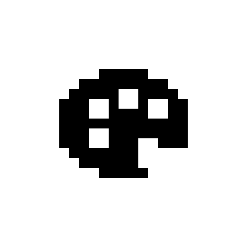
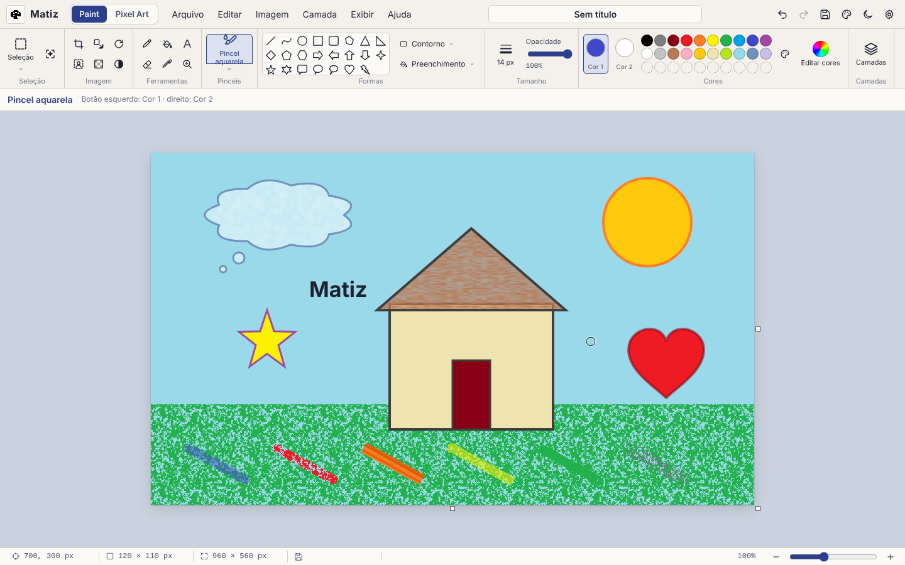
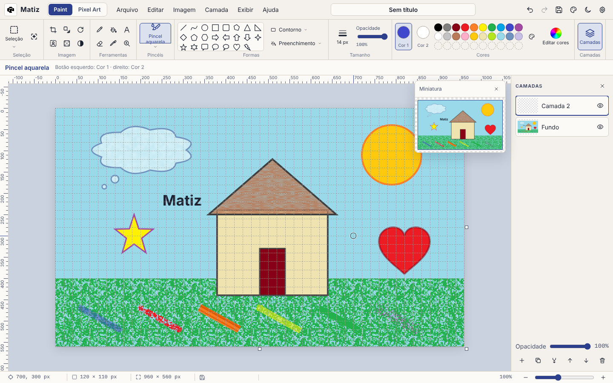
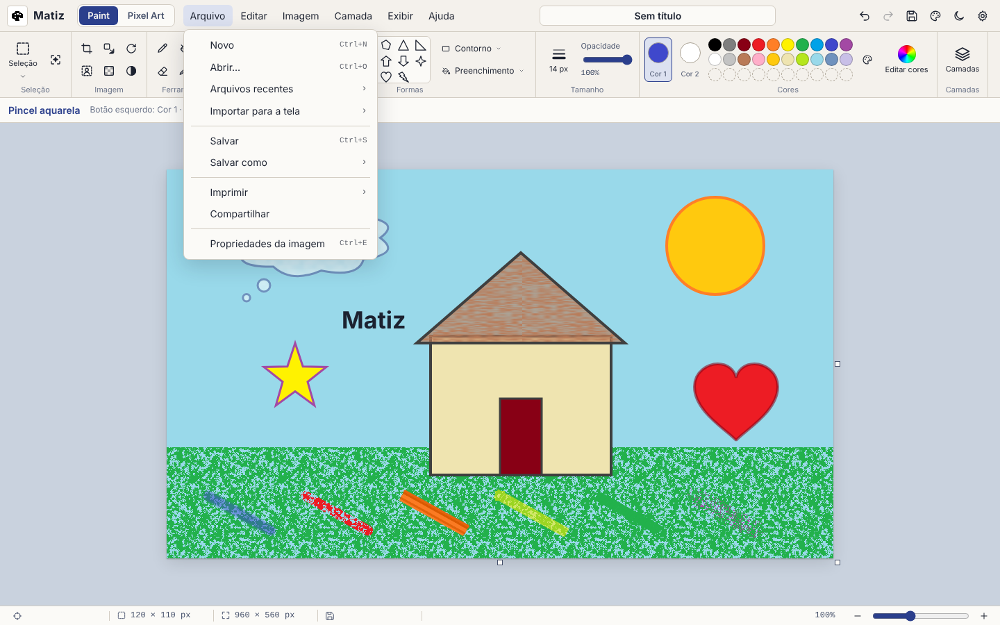
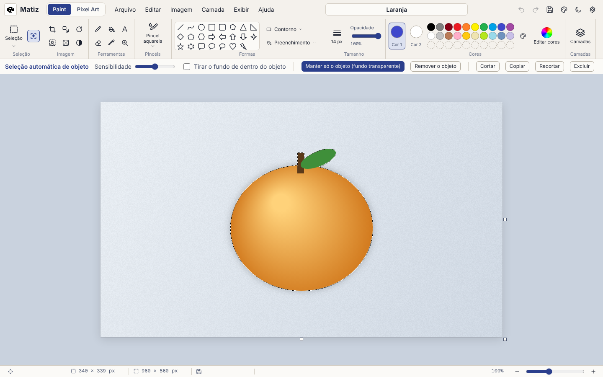
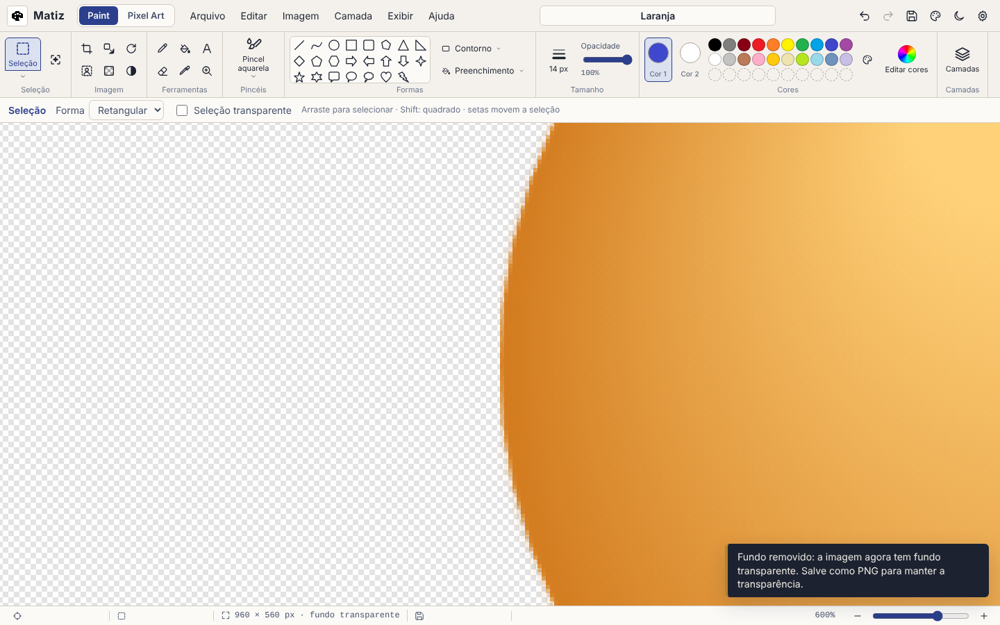
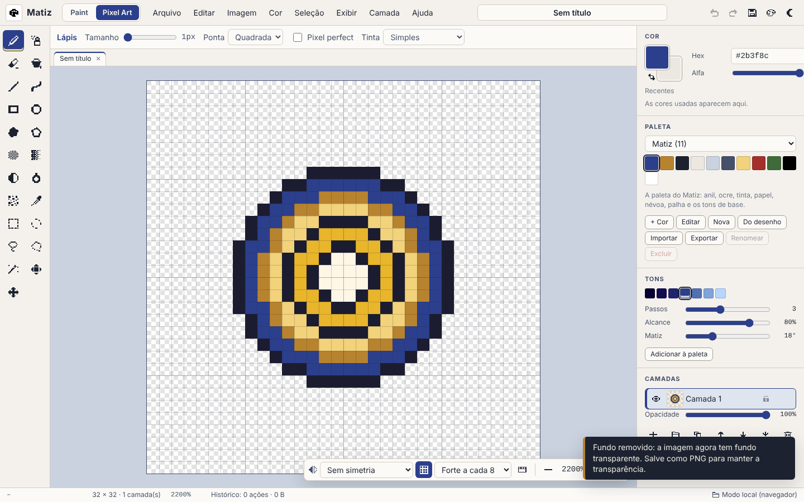
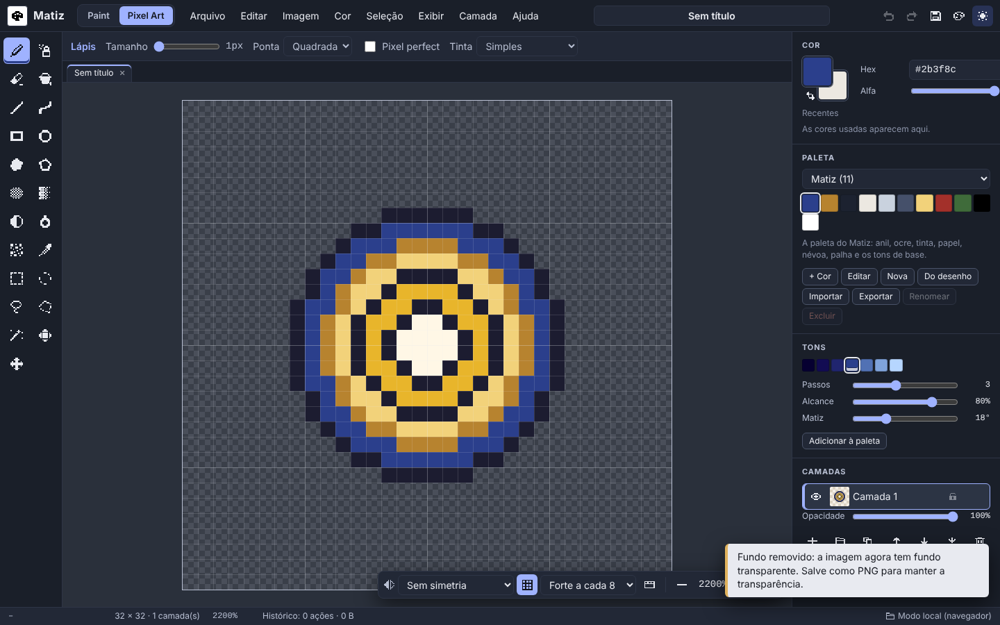
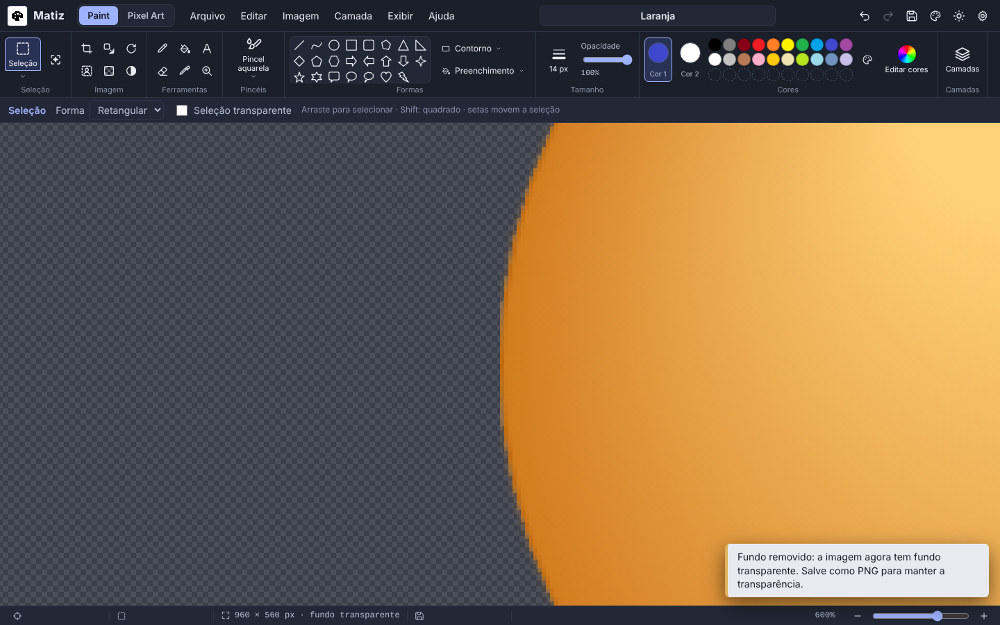
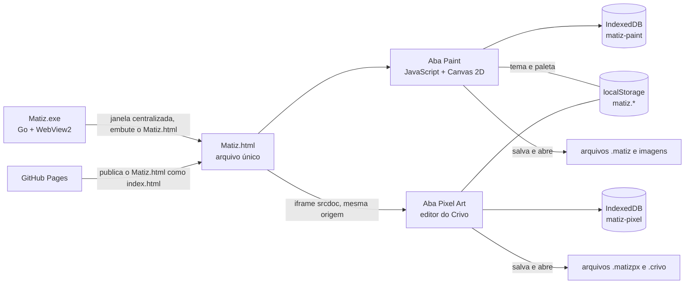

<p align="center">
  
</p>

<h1 align="center">Matiz<br><sub><sup><sup><sub>Copyright (©) 2026 Erik Pimenta</sub></sup></sup></sub></h1>

<p align="center">
  Editor de imagens com a cara e as funções do Paint do Windows: seleção retangular, de forma livre e <b>automática de objeto</b>, cortar, redimensionar e inclinar, girar e virar, lápis, balde, texto, borracha, seletor de cores, lupa, nove pincéis artísticos, as 23 formas com sete estilos de contorno e de preenchimento, tamanho, opacidade, Cor 1 e Cor 2, editar cores, camadas, réguas, linhas de grade, miniatura, tela inteira, imprimir e salvar em PNG, JPEG, BMP, GIF, TIFF, WEBP e ICO.<br>
  Tira o fundo de uma foto com um clique e salva o PNG <b>transparente</b>, com borda suave (antialiasing calculado por <i>alpha matting</i>) e sem o halo da cor antiga do fundo.<br>
  Na aba <b>Pixel Art</b>, o editor de pixel art do Crivo, só para desenho: 23 ferramentas, camadas, grupos e modos de mistura, paletas, simetria, pontilhado e exportação da matriz para jogos.<br>
  Roda de duas maneiras: app desktop para Windows (<code>Matiz.exe</code>) ou arquivo único no navegador (<code>Matiz.html</code>), sem instalar nada e sem enviar nada para a internet.<br>
  Ou abra direto no navegador, sem baixar nada: <a href="https://ravelroot.github.io/Raster-Paint-and-Pixel-Art-Editor/">ravelroot.github.io/Raster-Paint-and-Pixel-Art-Editor</a>.<br>
  Pronto para baixar e usar.
</p>

<p align="center">
  JavaScript (módulos ES, Canvas 2D) · HTML5 · CSS3 · IndexedDB · Go 1.24 + WebView2 (app desktop) · Node Test Runner · Playwright · GitHub Actions · GitHub Pages
</p>

---

> **Manual completo:** [`Manual-Matiz.pdf`](Manual-Matiz.pdf) explica as maneiras de rodar (app desktop, arquivo único e GitHub Pages), cada grupo da faixa de ferramentas da aba Paint (Seleção, Imagem, Ferramentas, Pincéis, Formas, Tamanho, Cores e Camadas), os menus, a seleção automática de objeto e o fundo transparente passo a passo, a matemática por trás dos algoritmos (preenchimento, k-médias no OKLab, limiar de Otsu, distância de chanfro, *alpha matting* e descontaminação de cor, corte mediano do GIF), a aba Pixel Art, os formatos de arquivo, os atalhos, a arquitetura, a segurança, os testes e a solução de problemas (cópia em [`docs/`](docs/Manual-Matiz.pdf)).

> **Banco de dados:** [`Banco-de-Dados-Matiz.pdf`](Banco-de-Dados-Matiz.pdf) descreve onde o Matiz guarda os dados (os bancos IndexedDB `matiz-paint` e `matiz-pixel`, as chaves do `localStorage` e os formatos `.matiz` e `.matizpx`), com diagrama, campos, tipos, limites e regras de validação, e sugere a arquitetura de um banco PostgreSQL para quando o Matiz ganhar contas e sincronização na nuvem: tabelas, chaves, índices, restrições, armazenamento das camadas e consultas prontas (cópia em [`docs/`](docs/Banco-de-Dados-Matiz.pdf)).

> **Versão 1.0.0 (Atual):** primeira versão. A aba **Paint** reproduz o Paint do Windows (faixa de ferramentas, menus Arquivo, Editar, Imagem, Camada, Exibir e Ajuda, barra de status com zoom), com camadas, opacidade do traço, nove pincéis, 23 formas editáveis depois de desenhadas, texto formatado, seleção transparente, recortar, copiar e colar com a área de transferência do sistema, arrastar imagens para a tela, importar da câmera, imprimir com configuração de página, arquivos recentes e rascunho automático. A **seleção automática de objeto** acha o objeto sozinha e deixa o fundo transparente com borda suave. A aba **Pixel Art** traz o editor do Crivo sem animação. Detalhes em [Aba Paint](#aba-paint).

<p align="center">
  
</p>

## O que o Matiz faz

- **Duas abas:** **Paint**, o editor de imagens no estilo do Paint do Windows, e **Pixel Art**, o editor de pixel art em matriz do Crivo (sem animação). O seletor fica no topo das duas, ao lado do logo, e cada aba guarda o próprio desenho.
- **Seleção:** retangular (Shift: quadrada), de forma livre, **automática de objeto**, selecionar tudo, inverter seleção, excluir e **seleção transparente** (a Cor 2 some ao mover ou colar). A seleção se move com o mouse ou as setas e tem oito alças para esticar.
- **Imagem:** cortar para a seleção, redimensionar por porcentagem ou pixels (com ou sem suavizar) e inclinar na horizontal e na vertical, girar 90° para os dois lados e 180°, virar na horizontal e na vertical, inverter cores, **remover fundo**, **tornar fundo transparente** e aparar bordas transparentes. Sem seleção, vale para a imagem inteira; com seleção, só para ela.
- **Ferramentas:** lápis (1 a 32 px, Shift faz linha reta), preenchimento com tolerância, texto (fonte, tamanho, negrito, itálico, sublinhado, tachado, alinhamento e fundo com a Cor 2), borracha (deixa transparente ou com a Cor 2; o botão direito troca só a Cor 1 pela Cor 2, como no Paint), seletor de cores (volta para a ferramenta anterior) e lupa.
- **Pincéis:** pincel, pincel caligráfico, caneta caligráfica, aerógrafo, pincel a óleo, giz de cera, marcador, lápis natural e pincel aquarela, de 1 a 100 px, com opacidade de 1% a 100%.
- **Formas:** as 23 do Paint (linha, curva, oval, retângulo, retângulo arredondado, polígono, triângulo, triângulo retângulo, losango, pentágono, hexágono, quatro setas, estrelas de quatro, cinco e seis pontas, três balões de fala, coração e raio). Contorno e preenchimento em sete estilos: nenhum, cor sólida, giz de cera, marcador, óleo, lápis natural e aquarela. Depois de desenhada, a forma continua editável: dá para mover, esticar e trocar cor, estilo e tamanho antes de aplicar.
- **Cores:** Cor 1 e Cor 2, as 20 cores básicas do Paint mais 10 espaços personalizados, **Editar cores** (espectro, matiz, hex, RGB e HSV) e mais nove conjuntos de cores para a grade, mostrados só como faixas de cores.
- **Camadas:** nova, duplicar, mesclar com a de baixo, subir, descer, arrastar para reordenar, renomear (duplo clique), ocultar e opacidade, com miniaturas.
- **Exibir:** zoom de 12,5% a 3200% (roda do mouse com Ctrl, lupa, controle deslizante ou menu), ajustar à janela, réguas, linhas de grade, barra de status, miniatura flutuante, painel de camadas e tela inteira (F11).
- **Arquivo:** novo (fundo branco, **transparente** ou Cor 2), abrir (PNG, JPEG, BMP, GIF, WEBP, ICO, SVG, AVIF e `.matiz`), arquivos recentes com miniatura, importar para a tela (de arquivo ou da câmera), salvar e salvar como em sete formatos de imagem ou como projeto `.matiz` com camadas, imprimir, configurar página, visualizar impressão, compartilhar, definir como plano de fundo da área de trabalho (no app desktop) e propriedades da imagem (tamanho em pixels, polegadas ou centímetros, DPI e fundo transparente).
- **Área de transferência e arrastar:** Ctrl+C e Ctrl+X copiam para a área de transferência do sistema, Ctrl+V cola imagens de qualquer programa (se a imagem for maior que a tela, o Matiz pergunta se pode aumentar a tela), "Colar de" cola de um arquivo e arrastar uma imagem para a tela importa como seleção flutuante.
- **Histórico:** desfazer e refazer guardam só a área que mudou, com limite de memória, e um rascunho automático recupera o desenho se a janela fechar.
- **Paletas da interface:** cinco paletas, com tema claro e escuro, mostradas só como faixas de cores. Detalhes em [Paletas de cores da interface](#paletas-de-cores-da-interface).
- **Seguro por padrão:** Content-Security-Policy restrita (só o script embutido roda, conferido por hash SHA-256), nenhuma conexão de rede, nada de dado do usuário em `innerHTML`, arquivos validados antes de abrir e o app desktop só grava arquivos escolhidos na janela Salvar como. Detalhes em [Qualidade e segurança](#qualidade-e-segurança).

## Aba Paint

A aba Paint segue a organização do Paint do Windows 11: na primeira linha, os menus e as ações rápidas; embaixo, a faixa de ferramentas com os grupos **Seleção**, **Imagem**, **Ferramentas**, **Pincéis**, **Formas**, **Tamanho**, **Cores** e **Camadas**; logo abaixo, a barra de opções da ferramenta atual (fonte do texto, tolerância do balde, sensibilidade da seleção de objeto); no meio, a tela com as alças de tamanho; e, no rodapé, a barra de status com a posição do cursor, o tamanho da seleção, o tamanho da imagem, o tamanho do arquivo e o zoom.

| Grupo | O que tem |
|---|---|
| **Seleção** | Retangular, forma livre, seleção automática de objeto, selecionar tudo, inverter seleção, excluir, seleção transparente |
| **Imagem** | Cortar, redimensionar e inclinar, girar e virar, remover fundo, tornar fundo transparente, inverter cores |
| **Ferramentas** | Lápis, preenchimento com cor, texto, borracha, seletor de cores, lupa |
| **Pincéis** | Pincel, pincel caligráfico, caneta caligráfica, aerógrafo, pincel a óleo, giz de cera, marcador, lápis natural, pincel aquarela |
| **Formas** | 23 formas, contorno e preenchimento em sete estilos |
| **Tamanho** | 1 a 100 px por ferramenta (o lápis vai até 32 px) e opacidade do traço |
| **Cores** | Cor 1, Cor 2, 20 cores básicas, 10 personalizadas, conjuntos de cores e Editar cores |
| **Camadas** | Mostra ou esconde o painel de camadas |

O botão esquerdo do mouse pinta com a Cor 1 e o direito com a Cor 2, em todas as ferramentas. O contorno das formas usa a Cor 1 e o preenchimento usa a Cor 2. Ao mover ou excluir uma seleção na camada de fundo, a área vazia fica com a Cor 2; nas outras camadas, ou quando o fundo é transparente, fica transparente.

<p align="center">
  
  
</p>

## Seleção automática de objeto e fundo transparente

O Matiz separa o objeto do fundo **sem contornar à mão**, de três jeitos:

1. **Detectar objeto principal:** escolha a ferramenta **Seleção automática de objeto** (O) e clique em **Detectar objeto principal**. O Matiz acha sozinho o objeto em destaque na imagem inteira.
2. **Clicar no objeto:** com a mesma ferramenta, clique no objeto. Se houver mais de um, só o clicado é escolhido.
3. **Retângulo em volta:** se a foto tiver muita coisa, arraste um retângulo folgado em volta do objeto para limitar a busca.

Com o objeto selecionado, a barra de opções mostra **Manter só o objeto (fundo transparente)**, **Remover o objeto**, cortar, copiar, recortar e excluir, além da **sensibilidade** e da opção **Tirar o fundo de dentro do objeto** (para o fundo que aparece entre um braço e o corpo, por exemplo). Mudar qualquer uma das duas refaz a seleção na hora. **Imagem › Remover fundo** faz tudo de uma vez, e **Imagem › Tornar fundo transparente** tira a cor que encosta nas bordas, com tolerância e prévia. Depois, salve como PNG (ou WEBP, TIFF, GIF ou ICO) para manter a transparência.

Como funciona, em quatro etapas e sem IA na nuvem:

| Etapa | O que o Matiz faz |
|---|---|
| **Modelo do fundo** | Lê os pixels da borda da área, converte para o espaço de cor OKLab e agrupa em até seis cores de fundo com k-médias |
| **Separação** | Mede a distância de cada pixel até a cor de fundo mais próxima, escolhe o limite pelo método de Otsu e preenche o fundo a partir das bordas; pedaços soltos e minúsculos são descartados |
| **Borda sem serrilhado** | Alisa o contorno (desfoque e novo limiar) e calcula a distância de chanfro até a borda; na faixa de 2 px em volta dela, a transparência de cada pixel sai da cobertura geométrica combinada com a estimativa por cor (*alpha matting* entre a cor média do objeto e a do fundo ali perto) |
| **Sem halo** | Descontamina a cor dos pixels semitransparentes, tirando a parte que vinha do fundo antigo, para o PNG não ficar com franja |

Nos testes com um círculo antialiasado sobre fundo com ruído, a transparência da borda erra em média 5% da cobertura real do pixel, e a cor da borda fica a cerca de 6 níveis (de 255) da cor verdadeira do objeto.

<p align="center">
  
  
</p>

## Aba Pixel Art

A aba Pixel Art é o editor do [Crivo](https://github.com/ravelroot/Pixel-Art-Matrix-Editor) dentro do Matiz, só para desenho: sem linha do tempo, quadros, papel cebola, GIF animado, Caderno ou Estúdio de jogo. Ficam as 23 ferramentas (lápis com pixel perfect, spray, borracha, balde, linha, curva, retângulo, elipse, contorno livre, polígono, pontilhado, degradê pontilhado, clarear e escurecer, desfocar, embaralhar, conta-gotas, seleções retangular e elíptica, laço, laço poligonal, varinha mágica, mover pixels e mover a visão), camadas, grupos, 19 modos de mistura, camadas de tiles e de referência, paletas (Game Boy, NES, Pico-8, CGA, Commodore 64, 1 bit e outras), gerador de tons no OKLCH, ajustes de cor, simetria, grade, modo ladrilho, abas de projetos, pré-visualização (F7) e exportação em PNG, JPEG, GIF, `.ase` e dados da matriz em JSON, CSV, JavaScript, Python, C e Java.

Os projetos de pixel art são salvos em `.matizpx`, e os arquivos `.crivo` também abrem (se o arquivo tiver animação, aparece o primeiro quadro). O tema e a paleta da interface valem para as duas abas ao mesmo tempo.

<p align="center">
  
  
</p>

## Paletas de cores da interface

O botão com o ícone de paleta, no canto superior direito das duas abas, troca as cores da interface. A escolha muda barras, painéis, menus e a área em volta da tela e funciona junto com o tema claro ou escuro (botão da lua e do sol). As cores do desenho não mudam.

| Paleta | Tema claro | Tema escuro |
| --- | --- | --- |
| **1** (padrão) | `#ECE8E1` `#C9D2DE` `#F2D27A` `#2B3F8C` | fundo `#12151C`, destaque `#9FB2FF` |
| **2** | `#E6DDCE` `#A3B4BE` `#F6E4A6` `#5D1C16` | fundo `#1D1613`, destaque `#F6E4A6` |
| **3** | `#F5F4F4` `#BAB7B6` `#4D4B4B` `#000000` | fundo `#020202`, destaque `#FFFFFF` |
| **4** | `#F3F1EC` `#7FA7B8` `#17212B` `#A8235A` | fundo `#0F161B`, destaque `#F0679A` |
| **5** | `#E8E8E8` `#D9D1CE` `#AB9D9D` `#000000` | fundo `#000000`, destaque `#E8E8E8` |

A escolha fica salva neste navegador (ou no app desktop). As paletas são variáveis CSS em `:root[data-palette]` no [`app/css/theme.css`](app/css/theme.css), e a lista fica em `UI_PALETTES` no [`app/shared/shell.js`](app/shared/shell.js).

<p align="center">
  
</p>

## Arquitetura



| Parte | Linguagem | Responsabilidade |
|---|---|---|
| `app/js/paint/core` | JavaScript | Núcleo sem DOM, testado no Node: cores (HSV, OKLab), operações de imagem (balde, girar, virar, recortar, fundo das bordas), seleção automática de objeto e refinamento da borda (`segment.js`), formas (`shapes.js`), motor dos pincéis e texturas (`brushes.js`), codificadores BMP, TIFF, ICO, quantização do GIF e DPI do PNG (`encoders.js`), histórico com limite de memória e o formato `.matiz` (`project.js`) |
| `app/js/paint/ui` | JavaScript | Documento com camadas em canvas, controlador (`app.js`: composição, histórico, seleção flutuante), visor (`view.js`: zoom, réguas, grade, alças, formigas da seleção), ferramentas (`tools.js`), operações (`operations.js`), arquivos (`files.js`), diálogos, menus suspensos, ícones em pixel art e armazenamento |
| `app/js/paint/index.js` e `ribbon.js` | JavaScript | Comandos, menus, atalhos, área de transferência, arrastar e soltar, impressão, barra de status, painel de camadas, miniatura e a faixa de ferramentas |
| `app/pixel` | JavaScript | A aba Pixel Art: o editor do Crivo sem animação, com armazenamento próprio (`matiz-pixel`) e o formato `.matizpx` |
| `app/shared/shell.js` | JavaScript | O que as duas abas dividem: seletor de abas, paletas da interface, tema e ponte com o app desktop |
| `Matiz.html` | HTML + JavaScript | O app inteiro num arquivo só, gerado por `scripts/build-portable.js`: a aba Pixel Art vai embutida em Base64 e abre num `iframe srcdoc` da mesma origem |
| `Matiz.exe` e `desktop/` | Go | App desktop para Windows: janela própria com o WebView2, **centralizada na tela**, com o `Matiz.html` embutido, atalho no menu Iniciar, janela Salvar como nativa e plano de fundo da área de trabalho |

### Como a imagem é guardada na memória

Cada camada da aba Paint é um `canvas` do tamanho da imagem. A tela mostra a composição das camadas visíveis, com a opacidade de cada uma; durante um traço, o pincel desenha numa camada temporária, e o acabamento (opacidade, textura do giz, do lápis e da aquarela, borracha) entra só na composição e na hora de aplicar, então um traço do marcador não escurece onde cruza a si mesmo. O limite é de 16384 pixels por lado e 50 megapixels por imagem.

### Como o histórico funciona

| Ação | O que fica guardado |
|---|---|
| Traço, forma, texto, balde, excluir | Só o retângulo que mudou, antes e depois |
| Mover ou colar uma seleção | A camada antes e depois |
| Estrutura (girar, redimensionar, cortar, camadas, fundo transparente) | Instantâneo de todas as camadas |

O histórico tem limite de 320 MB e 200 ações; quando passa, as ações mais antigas saem primeiro.

## Como rodar

| Maneira | Como subir | Precisa de | Onde ficam os desenhos |
|---|---|---|---|
| **1. App desktop** (`Matiz.exe`) | Dois cliques no `Matiz.exe` (ou pesquise **Matiz** no menu Iniciar depois da primeira vez); abre **centralizado na tela** | Windows 10 ou 11 (64 bits) | Nos arquivos que você salvar, e o rascunho em `%LOCALAPPDATA%\Matiz` |
| **2. Arquivo único** (`Matiz.html`) | Dois cliques no `Matiz.html`; abre no navegador | Um navegador atual | Nos arquivos que você salvar, e o rascunho no navegador (IndexedDB) |
| **3. GitHub Pages** | [ravelroot.github.io/Raster-Paint-and-Pixel-Art-Editor](https://ravelroot.github.io/Raster-Paint-and-Pixel-Art-Editor/) | Um navegador atual | Igual ao arquivo único |

### 1. App desktop (Matiz.exe)

1. Baixe o `Matiz.exe` da página [Releases](https://github.com/ravelroot/Raster-Paint-and-Pixel-Art-Editor/releases) ou da raiz do repositório.
2. Dê dois cliques. Na primeira vez, o Windows SmartScreen pode avisar que o app é de um editor desconhecido: clique em **Mais informações › Executar assim mesmo**.
3. A janela abre centralizada, com 85% da área útil da tela. Shift+F11 alterna a janela em tela cheia, e F11 mostra só a imagem, como no Paint.

O app usa o Microsoft Edge WebView2 Runtime, que já vem no Windows 10 e 11 atualizados; se faltar, o Matiz oferece abrir a página de download da Microsoft. Ele roda sem permissão de administrador, não abre portas e grava só nos arquivos que você escolher.

### 2. Arquivo único (Matiz.html)

Dê dois cliques no [`Matiz.html`](Matiz.html). Ele não precisa de servidor nem de internet. No Chrome e no Edge, o Ctrl+S abre a janela **Salvar como** para escolher a pasta; nos outros navegadores, o arquivo vai para Downloads.

### 3. GitHub Pages

O workflow [`pages.yml`](.github/workflows/pages.yml) publica o `Matiz.html` como `index.html` a cada push que mude o arquivo. Para ativar num repositório novo: **Settings › Pages › Build and deployment › Source: GitHub Actions**.

### Desenvolvimento local

```bash
npm run serve        # servidor de arquivos em http://localhost:5173 com os módulos separados
npm run portable     # gera o Matiz.html de novo a partir de app/
npm run desktop      # gera o Matiz.exe (precisa do Go 1.24)
```

## Formatos de arquivo

| Formato | Abrir | Salvar | Observação |
|---|---|---|---|
| `.matiz` | Sim | Sim | Projeto da aba Paint, em JSON, com todas as camadas em PNG, nomes, visibilidade, opacidade, DPI, fundo transparente e cores |
| PNG | Sim | Sim | Mantém a transparência e grava o DPI (bloco `pHYs`) |
| JPEG | Sim | Sim | Sem transparência: o fundo transparente vira branco |
| BMP | Sim | Sim | 24 bits, sem transparência |
| GIF | Sim | Sim | Até 255 cores (corte mediano) e transparência |
| TIFF | Não | Sim | RGBA sem compressão, com DPI |
| WEBP | Sim | Sim | Com transparência |
| ICO | Sim | Sim | Sete tamanhos de 16 a 256 px num arquivo só |
| SVG e AVIF | Sim | Não | Abrem como imagem |
| `.matizpx` e `.crivo` | Na aba Pixel Art | `.matizpx` | Projeto de pixel art |

## Armazenamento local

O Matiz não tem servidor: tudo fica no aparelho. A aba Paint usa o banco IndexedDB `matiz-paint` (arquivos recentes e rascunho), a aba Pixel Art usa o `matiz-pixel` (projetos salvos e rascunho) e as preferências ficam no `localStorage` com o prefixo `matiz.`. O [`Banco-de-Dados-Matiz.pdf`](Banco-de-Dados-Matiz.pdf) traz o esquema completo e a sugestão de banco PostgreSQL para uma versão com sincronização.

## Atalhos do teclado

| Atalho | Ação |
|---|---|
| Ctrl+N, Ctrl+O, Ctrl+S, F12 | Novo, abrir, salvar, salvar como |
| Ctrl+P, Ctrl+E | Imprimir, propriedades da imagem |
| Ctrl+Z, Ctrl+Y | Desfazer, refazer |
| Ctrl+X, Ctrl+C, Ctrl+V | Recortar, copiar, colar |
| Ctrl+A, Ctrl+Shift+A, Delete | Selecionar tudo, inverter seleção, excluir |
| Ctrl+W, Ctrl+Shift+X, Ctrl+Shift+I | Redimensionar e inclinar, cortar, inverter cores |
| Ctrl+R, Ctrl+G, F11 | Réguas, linhas de grade, tela inteira |
| Ctrl+PgUp, Ctrl+PgDn, Ctrl+0, Ctrl+1 | Ampliar, reduzir, ajustar à janela, 100% |
| Ctrl++, Ctrl+- | Aumentar e diminuir o tamanho do pincel |
| S, O, P, F, T, E, I, Z, B, U | Seleção, objeto, lápis, balde, texto, borracha, seletor de cores, lupa, pincéis, formas |
| X | Trocar a Cor 1 e a Cor 2 |
| Setas (Shift: 10 px) | Mover a seleção ou a forma |
| Enter, Esc | Aplicar, cancelar |
| Espaço + arrastar | Mover a visão |

Os atalhos da aba Pixel Art são os do Crivo e ficam em **Ajuda › Atalhos do teclado** dentro dela.

## Desenvolvimento e testes

```bash
npm test                                   # 141 testes do núcleo em JavaScript (Node 20+)
python -m unittest discover -s tests/e2e   # 9 testes ponta a ponta no Chromium (Playwright) com o Matiz.html
npm run portable -- --check                # confere se o Matiz.html está em dia com o código
npm run desktop -- --check                 # compila o Matiz.exe a partir do código atual
```

Para o teste ponta a ponta, instale antes `pip install playwright` e `python -m playwright install chromium`.

O `Matiz.html` é gerado a partir de `app/` por `scripts/build-portable.js`, sem bibliotecas: os módulos de cada aba viram um script embutido, o CSS e o ícone vão junto, a aba Pixel Art entra em Base64 para abrir num `iframe srcdoc`, e a página ganha uma Content-Security-Policy com o hash dos dois scripts. O `Matiz.exe` é gerado por `scripts/build-desktop.js`, que copia o `Matiz.html` para `desktop/`, desenha o ícone a partir do logo, grava a versão nas propriedades do arquivo e compila o código Go para Windows de 64 bits. O GitHub Actions roda os testes, confere o `Matiz.html`, compila o `Matiz.exe` (e guarda como artefato), roda o `go vet` e os testes no Chromium a cada push.

## Qualidade e segurança

Resultado da rodada de testes da versão 1.0.0: **150 testes**, todos passando, e nenhum problema apontado pelo `go vet`.

| Verificação | O que cobre | Resultado |
|---|---|---|
| Núcleo da aba Paint (30) | Balde com tolerância e modo global, girar e virar sem perder pixels, recorte, fundo das bordas, limites, geometria e ângulo de 45°, as 23 formas dentro da caixa e fechadas, nove pincéis, aerógrafo determinístico, texturas, BMP, TIFF, ICO, GIF com até 255 cores, DPI do PNG com CRC, `.matiz` de ida e volta e com dados maliciosos, histórico com limite de memória, cores; seleção de objeto sozinha, por clique e por retângulo, borda suave com erro médio abaixo de 8% e descontaminação da cor | 30 de 30 |
| Núcleo da aba Pixel Art (111) | Os testes do Crivo para cores, geometria, balde, RLE, histórico, formato, exportação, pontilhado, seleção, camadas, modos de mistura, tilemaps, `.ase`, GIF e comandos de pixel art, adaptados ao `.matizpx` | 111 de 111 |
| Interface (9) | `Matiz.html` aberto do disco no Chromium: CSP presente, nenhuma requisição de rede, nenhum erro no console, lápis com desfazer e refazer, nove pincéis e formas, texto, seleção automática de objeto com PNG transparente e borda suave, `.matiz` de ida e volta, projeto malicioso recusado, mover seleção e fundo transparente, e a aba Pixel Art (desenho, sem linha do tempo, tema sincronizado) | 9 de 9 |
| App desktop | Compilação para Windows de 64 bits e `go vet` | 0 problemas |

O `Matiz.html` leva a própria Content-Security-Policy numa tag `<meta>`: `default-src 'none'`, scripts só com o hash SHA-256 dos dois scripts embutidos (sem `eval`), nenhuma conexão (`connect-src 'none'`), nenhum objeto, `base-uri` e `form-action` bloqueados. Nenhum dado do usuário passa por `innerHTML`: nomes de arquivos, camadas e textos entram sempre como texto. Os arquivos abertos são validados antes de usar: tamanho máximo de 256 MB, imagens de até 16384 pixels por lado e 50 megapixels, projetos `.matiz` com formato, versão, tamanho, número de camadas (até 64) e PNGs conferidos, e nomes limpos de caracteres proibidos. As preferências gravadas no navegador só são aceitas se estiverem na lista de valores válidos. O servidor de desenvolvimento (`npm run serve`) só escuta em `127.0.0.1` e envia cabeçalhos de segurança. O app desktop roda sem permissão de administrador, não abre portas e só grava arquivos que você escolheu na janela Salvar como, além da imagem do plano de fundo, que valida como PNG.

### Estrutura

```text
Matiz.exe                   app desktop para Windows, que abre centralizado (gerado)
Matiz.html                  o app inteiro num arquivo só, que abre sem servidor (gerado)
app/                        código do app
  index.html                página da aba Paint
  css/                      tema e paletas, componentes e a aba Paint
  img/                      logo e ícone
  js/main.js                abre o app, troca de aba, tema e paleta
  js/paint/core/            núcleo da aba Paint, sem DOM, testado no Node
  js/paint/ui/              interface da aba Paint
  pixel/                    aba Pixel Art (editor do Crivo sem animação)
  shared/                   o que as duas abas dividem
desktop/                    código do app desktop em Go (janela WebView2, Salvar como, atalho no menu Iniciar, plano de fundo, manifesto)
scripts/                    servidor local em Node e geradores do Matiz.html e do Matiz.exe
tests/js/paint/             testes do núcleo da aba Paint
tests/js/pixel/             testes do núcleo da aba Pixel Art
tests/e2e/                  testes ponta a ponta da interface (Playwright)
docs/                       manuais em PDF e imagens do README
.github/workflows/          CI (testes, Matiz.html, Matiz.exe, go vet e Playwright) e publicação no GitHub Pages
```

### Componentes de terceiros

O Matiz depende de componentes com licenças próprias, que continuam valendo para cada um deles:

| Componente | Uso no projeto | Licença |
|---|---|---|
| [go-webview2](https://github.com/jchv/go-webview2) | Janela do app desktop com o WebView2 (embutido no `Matiz.exe`) | MIT |
| [go-winloader](https://github.com/jchv/go-winloader) | Carregamento do WebView2 pelo go-webview2 (embutido no `Matiz.exe`) | ISC |
| [golang.org/x/sys](https://pkg.go.dev/golang.org/x/sys) | Chamadas ao Windows no app desktop (embutido no `Matiz.exe`) | BSD-3-Clause |
| [goversioninfo](https://github.com/josephspurrier/goversioninfo) | Ícone, versão e manifesto do `Matiz.exe` (só no build) | MIT |
| [Playwright](https://playwright.dev/python/) | Testes ponta a ponta (só no desenvolvimento) | Apache-2.0 |

O Microsoft Edge WebView2 Runtime faz parte do Windows e não é redistribuído no `Matiz.exe`. O app não usa bibliotecas externas no navegador: os ícones são desenhados em pixel art no próprio código e a interface usa as fontes do sistema.

"Paint" e "Windows" são marcas da Microsoft, citadas só como referência de estilo; o Matiz não é afiliado à Microsoft. As paletas Game Boy, NES, Pico-8, CGA e Commodore 64 reproduzem as cores dos respectivos sistemas apenas como referência. Os nomes pertencem aos seus donos.

## Licença

Copyright (©) 2026 Erik Pimenta. Todos os direitos reservados.

O Matiz é distribuído sob uma [licença de uso](LICENSE) própria:

| Pode | Não pode |
|---|---|
| Baixar e usar de graça, como app desktop, `Matiz.html` ou pelo GitHub Pages | Modificar o Matiz ou criar versões derivadas |
| Configurar pelo tema, pelas paletas e pelas preferências | Copiar o código, no todo ou em parte, para outros projetos |
| Usar o que você cria como quiser, inclusive em projetos comerciais | Redistribuir, vender ou publicar o Matiz em outros lugares |
